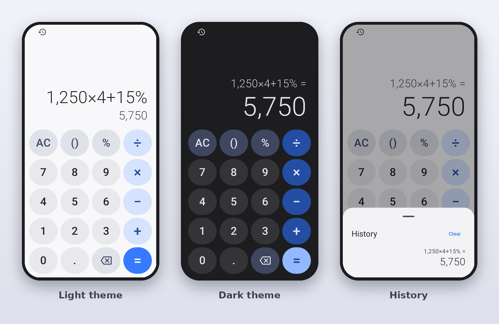

# Calculator


 


 


 


A fast, fully offline calculator for Android, built with Kotlin and Jetpack Compose. Design inspired by the Apple, Google and Samsung calculators.

## Screenshots


## Features
- 100% offline: the app requests **no permissions**, not even internet
- Haptic feedback on every key, with distinct feedback for equals, errors and long-press
- Exact decimal math (`0.1 + 0.2 = 0.3`) with no limit on expression length, digits per number, or result size
- Live result preview while typing
- Parentheses, percent (`50 + 10% = 55`), implicit multiplication (`2(3+4)`)
- Calculation history saved on the device
- Swipe the display to delete, long-press the result to copy
- Material You dynamic colors, dark/light theme, TalkBack support, landscape layout

## Download
Get the latest APK from the [Releases](https://github.com/mananmadani/CALCULATOR-ANDROID/releases/latest) page.

1. Download `app-release.apk`
2. Open it on your phone (Android 8.0+)
3. Allow "install from this source" if asked

## Build from source
```
gradle assembleRelease
```
Or push to GitHub: the workflow in `.github/workflows/build.yml` builds a signed APK automatically.

## Releasing a new version
Create a new release with a tag such as `v1.1.0`. The workflow builds the APK and attaches it to the release.

## Tech
Kotlin · Jetpack Compose · Material 3 · BigDecimal expression parser · Min SDK 26

## License
MIT. See [LICENSE](LICENSE).
